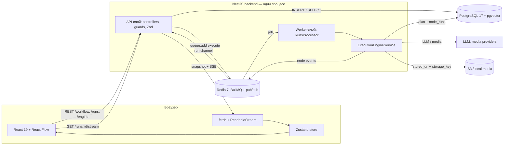
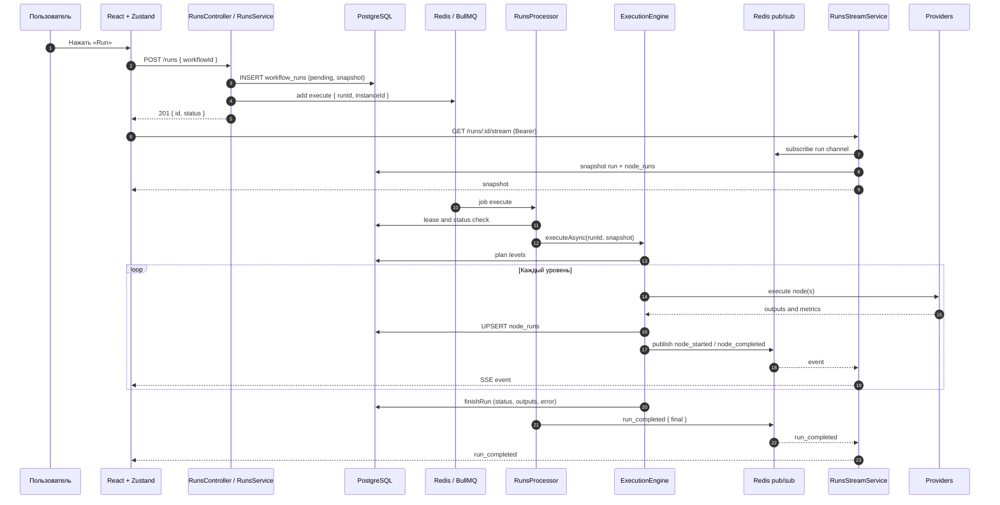

# ARCHITECTURE — IIChatTools AI Workflow Builder

**Файл:** `docs/development/ARCHITECTURE.md`
**Версия:** 1.1
**Дата:** 2026-10-19
**Статус:** актуален для **v0.10.0**
**Для кого:** новый разработчик, DevOps, автор нового узла/провайдера
**Связанные:** [RULES](RULES.md), [DESIGN v0.9](v0.9/DESIGN_V09_FEATURES.md),
[DESIGN v0.10](v0.10/DESIGN_V010_FEATURES.md),
[GETTING_STARTED](GETTING_STARTED.md), [RELEASES](RELEASES.md)

> **Как читать.** Документ идёт по C4-модели: контекст → контейнеры →
> компоненты, затем динамический сценарий запуска и ключевые паттерны.
> Схемы — Mermaid; они рендерятся на GitHub без дополнительных инструментов.
>
> **Граница документа.** Здесь описано **текущее** состояние (`v0.10.0`).
> Детали реализации срезов v0.10 — в
> [`v0.10/DESIGN_V010_FEATURES.md`](v0.10/DESIGN_V010_FEATURES.md).

---

## 0. TL;DR

| Вопрос | Короткий ответ |
|---|---|
| Что за система? | Визуальный конструктор AI-сценариев: граф узлов → фоновое выполнение → результат в UI |
| Из чего состоит? | React SPA + NestJS backend (API и BullMQ-worker в одном процессе) + PostgreSQL 17/pgvector + Redis + S3/local |
| Как запускается сценарий? | `POST /runs` создаёт строку `pending`, ставит job в BullMQ; worker планирует и выполняет граф |
| Как UI узнаёт прогресс? | `GET /runs/:id/stream` (SSE): сначала `snapshot`, затем события из Redis pub/sub |
| Как выполняется граф? | Уровни Кана: уровни последовательно, узлы внутри уровня — параллельно (`Promise.allSettled`) |
| Что при падении узла? | Зависимые узлы получают `skipped`; независимые ветки продолжают работу; запуск — `failed` |
| Где выполняются JS-выражения? | QuickJS-WASM (`SANDBOX_ENABLED`, по умолчанию выключен) |
| Где хранятся медиа и документы? | `./data/media` (local) или S3-совместимый бакет; в `node_runs.stored_url` — своя ссылка, в `node_runs.storage_key` — ключ объекта (с v0.10) |

---

## 1. C4 Level 1 — System Context

**Система:** IIChatTools AI Workflow Builder — веб-приложение, в котором
пользователь собирает граф из узлов, запускает его и получает результаты
выполнения (текст, медиа, данные) в браузере.

| Актор / система | Тип | Взаимодействие |
|---|---|---|
| **Пользователь** | человек | Собирает граф, сохраняет, запускает, смотрит прогресс и результаты |
| **Браузер** | клиент | React SPA; JWT access-токен, refresh-cookie; SSE-поток |
| **Backend** | наша система | REST API, auth/Share, планирование и выполнение графов |
| **PostgreSQL 17 + pgvector** | инфраструктура | Графы, запуски, история узлов, пользователи, Share, векторы, память |
| **Redis 7** | инфраструктура | Очередь BullMQ, pub/sub событий запуска |
| **S3 / локальный диск** | инфраструктура | Копии медиа-результатов (local/S3) |
| **LLM-провайдеры** | внешняя система | Anthropic, OpenAI, RouterAI, GPTunnel, DeepSeek, Yandex AI Studio, LM Studio |
| **Media-провайдеры** | внешняя система | CreativeLab, Replicate, FAL, OpenAI Images |
| **OTel collector** | внешняя система (опц.) | Приём трейсов OTLP/HTTP при `OTEL_ENABLED=true` |

**Границы доверия:**

- браузер и данные графа — **недоверенные**: `data` узлов валидируется Zod
  внутри исполнителя, а не на уровне `NodeDto`;
- ответы LLM/media — **недоверенные**: не исполняются, не вставляются
  в HTML без проверки;
- пользовательский JS — **только QuickJS-WASM**, без доступа к Node.js;
- файлы media — **вне `dist/`**, доступ через контролируемые пути.

---

## 2. C4 Level 2 — Containers

### 2.1 Диаграмма контейнеров и потока данных



### 2.2 Контейнеры

| Контейнер | Технологии | Код | Ответственность |
|---|---|---|---|
| **SPA** | React 19, Vite 8, `@xyflow/react` 12, Zustand 5, Tailwind 4 | `web/src/` | Холст, каталог узлов, формы, run-состояние, SSE-клиент |
| **API** | NestJS 12, TypeScript 6 (ESM), Zod | `src/*/*.controller.ts`, `src/*/*.service.ts` | Auth, CRUD workflow, Share, создание запуска, SSE, модели |
| **Worker** | `@nestjs/bullmq` (`WorkerHost`) | `src/runs/runs.processor.ts` | Приём job, lease/retry, запуск executor'а |
| **Execution Engine** | TypeScript | `src/engine/execution-engine.service.ts` | Планирование, уровни, выполнение узлов, запись `node_runs` |
| **PostgreSQL** | PostgreSQL 17, pgvector | `src/db/schema.ts`, `drizzle/` | Единственное долговременное хранилище домена |
| **Redis** | Redis 7, BullMQ, ioredis | `src/redis/redis.module.ts`, `src/runs/` | Очередь, pub/sub, изоляция инстансов |
| **Media Storage** | FS или AWS SDK v3 | `src/media/media-storage.service.ts` | Local/S3, presigned URL, TTL, стриминг |
| **Providers** | HTTP/SDK | `src/llm/`, `src/media/` | LLM, embeddings, генерация медиа |
| **Observability** | OpenTelemetry, Pino | `src/observability/` | Трейсы `run.execute`, `node.execute`, `agent.step`, логи |

> **Важно:** API и Worker — **один NestJS-процесс** (`RunsProcessor`
> зарегистрирован в `RunsModule`). Логически это разные контейнеры, поэтому
> worker можно вынести в отдельный процесс без изменения контрактов, но сейчас
> деплой — один backend. Это упрощает dev и усложняет масштабирование:
> см. § 7.4.

### 2.3 Внешние порты

| Порт | Назначение | Где |
|---|---|---|
| `3000` | Backend HTTP + SSE | `src/main.ts` (`PORT`) |
| `5173` | Vite dev-server | `web/vite.config.ts` (host `127.0.0.1`) |
| `5433` → `5432` | PostgreSQL в dev Docker Compose | `docker-compose.yml` |
| `6379` | Redis в dev Docker Compose | `docker-compose.yml` |
| `5434` → `5432` | PostgreSQL в prod Compose (только loopback) | `docker-compose.prod.yml` (`DB_PORT`) |
| `6380` → `6379` | Redis в prod Compose (только loopback) | `docker-compose.prod.yml` (`REDIS_PORT`) |
| `4318` | OTLP/HTTP collector (опц.) | `OTEL_EXPORTER_OTLP_ENDPOINT` |

> Порты prod-БД/Redis вынесены на `5434`/`6380`, чтобы prod-стек мог
> работать одновременно с dev-стеком на `5433`/`6379`. Наружу они
> публикуются только на `127.0.0.1`.

Vite проксирует префиксы из `web/src/lib/api-prefixes.ts`:
`workflow`, `engine`, `llm`, `media`, `auth`, `templates`, `runs`, `nodes`.
Список — единый источник правды для dev-proxy и паритетных тестов.

---

## 3. C4 Level 3 — Components

### 3.1 Backend: модули и ответственность

| Модуль / сервис | Файлы | Что делает |
|---|---|---|
| `AppModule` | `src/app.module.ts` | Config (Zod), Throttler, BullMQ root, сборка модулей |
| `AuthModule` | `src/auth/` | Регистрация/логин, JWT access, refresh-cookie, guards |
| `WorkflowModule` | `src/workflow/` | CRUD графа, версии, Share, collaborators, export/import |
| `EngineModule` | `src/engine/` | Валидация, топологическая сортировка, план, исполнители |
| `RunsModule` | `src/runs/` | Очередь, `workflow_runs`, SSE, события, бюджет |
| `LlmModule` | `src/llm/` | Провайдеры, реестр моделей, стоимость, semaphore, кэш-токены |
| `MediaModule` | `src/media/` | Модели, провайдеры, генерация, storage, cleanup |
| `DocumentsModule` | `src/documents/` | DOCX из Markdown/JSON (`docx`), лимиты и ошибки рендера |
| `FilesystemModule` | `src/filesystem/` | Безопасный workspace `read_file`/`write_file` |
| `WebSearchModule` | `src/web-search/` | Провайдер Tavily для узла `web_search` |
| `SandboxModule` | `src/sandbox/` | QuickJS-WASM для `condition`/`code_eval` |
| `TemplatesModule` | `src/templates/` | Шаблоны из поставки и instantiate |
| `ObservabilityModule` | `src/observability/` | OTel SDK, `withSpanAsync`, Pino |
| `CostBudgetModule` | `src/runs/cost-budget.*` | Лимит стоимости запуска (USD/RUB), hard/soft |
| `DbModule` / `RedisModule` | `src/db/`, `src/redis/` | Глобальные Drizzle-клиент и Redis-клиент |

### 3.2 Frontend: ключевые компоненты

| Компонент | Файлы | Что делает |
|---|---|---|
| `App` / роутинг | `web/src/App.tsx`, `main.tsx` | `/workflow`, `/workflow/share/:token` |
| `Canvas` | `web/src/components/Canvas.tsx` | React Flow, хоткеи, автосохранение, каталог, миникарта |
| `TopBar` | `web/src/components/TopBar.tsx` | Имя, Save/Run, бюджет, Share, тема, язык, версия |
| `LoadModal` | `web/src/components/LoadModal.tsx` | Список workflow, удаление, шаблоны |
| `RunResultPanel` | `web/src/components/RunResultPanel.tsx` | Outputs, метрики, ошибки, логи |
| `ShareViewPage` | `web/src/components/ShareViewPage.tsx` | Read-only граф по Share-ссылке |
| `nodes/*` | `web/src/components/nodes/` | 22 компонента узлов (lazy), включая `WebSearchNode`, `DocumentGenNode`, `ReadFileNode`, `WriteFileNode` |
| `workflow` store | `web/src/stores/workflow.ts` | Граф, selection, run-state, план, notice |
| `run-stream` | `web/src/lib/run-stream.ts` | SSE через `fetch` + `ReadableStream`, reconnect |
| `sse-parser` | `web/src/lib/sse-parser.ts` | Разбор SSE-кадров (без `EventSource`) |
| `node-registry` | `web/src/lib/node-registry.ts` | Единый реестр типов, иконок, категорий, lazy-компонентов |
| `api` | `web/src/lib/api.ts` | REST-клиент, Bearer, refresh при 401 |

### 3.3 API surface (кратко)

| Группа | Маршруты |
|---|---|
| Auth | `POST /auth/register`, `/auth/login`, `/auth/refresh`, `/auth/logout`; `GET /auth/me` |
| Workflow | `POST/GET /workflow`; `GET/PATCH/DELETE /workflow/:id`; `:id/export`, `import`, `:id/share`, `:id/collaborators` |
| Engine | `POST /engine/validate`, `/engine/sort`, `/engine/plan` |
| Runs | `POST /runs`; `GET /runs/:id`, `/runs/:id/budget`, `/runs/:id/stream` (SSE) |
| LLM / Media | `GET /llm/models`; `GET /media/models`; `GET /media/file/:runId/:fileName` |
| Templates | `GET /templates`; `POST /templates/:id/instantiate` |

> REST-контракт ответов фиксируется в `docs/development/api-contract.json`,
> SSE — в `docs/development/sse-contract.json`; оба проверяются
> паритет-гейтами (KI-348, KI-352).

### 3.4 Данные

| Таблица | Назначение | Ключевое |
|---|---|---|
| `users` | Учётные записи | scrypt-хэш пароля, уникальный email |
| `refresh_tokens` | Refresh-сессии | sha256-хэш, `revoked_at`, ротация |
| `workflows` | Граф | `nodes`/`edges` JSONB, `version`, `share_token`, владелец |
| `workflow_collaborators` | Share-участники | PK `(workflow_id, user_id)`, роли `viewer/editor` |
| `workflow_vectors` | Векторы | `vector(1536)`, HNSW, коллекция + workflow |
| `workflow_memory` | Key-value память | PK `(workflow_id, key)`, JSONB-значение |
| `workflow_runs` | Запуск | `snapshot` графа, статус, `error`, timestamps |
| `node_runs` | Узел запуска | Уникальный `(run_id, node_id)`, inputs/outputs, метрики, `stored_url`, `storage_key` (v0.10) |

**Redis:**

- очередь `workflow-runs` (имя + `BULLMQ_PREFIX` + `REDIS_QUEUE_DB`);
- канал `run:<runId>` для событий прогресса;
- отдельное соединение на каждого SSE-подписчика (`duplicate()`).

**Файлы:**

- media local: `./data/media/<runId>/<nodeId>.<ext>`;
- S3: объект `<runId>/<fileName>`, ключ пишется в `node_runs.storage_key`;
- workspace (v0.10): `./data/workspace/{workflowId}/` — только local,
  относительные пути, лимит 5 МБ на файл.

---

## 4. Динамический сценарий: жизненный цикл Run

### 4.1 Последовательность

1. **Пользователь нажимает Run.** `TopBar` вызывает
   `startRunAsync(workflowId)` в Zustand-сторе.
2. **`POST /runs`.** `RunsController` валидирует body Zod-схемой и передаёт
   `RunsService.createRunAsync`.
3. **Проверка доступа и snapshot.** Сервис ищет workflow с правом `editor`
   (владелец или collaborator-editor). В `workflow_runs` вставляется строка
   `pending` со **снимком** `{ nodes, edges }`. Дальнейшие правки графа не
   меняют историю запуска.
4. **Постановка в очередь.** `queue.add('execute', { runId, instanceId })`.
   При ошибке Redis запуск компенсируется статусом `failed`, клиент получает
   500.
5. **Ответ и подписка.** UI получает `201 { id, status }`, пишет `runId` в
   `?runId=` (для F5) и открывает `GET /runs/:id/stream` с Bearer-токеном.
6. **SSE-снимок.** `RunsStreamService` **сначала** подписывается на Redis
   `run:<runId>`, затем читает `workflow_runs` + `node_runs`, переподписывает
   просроченные `stored_url` и отправляет `snapshot` первым сообщением.
7. **Worker берёт job.** `RunsProcessor` валидирует payload, проверяет
   `instanceId`, lease (`started_at` + `RUN_STALE_THRESHOLD_MS`) и статус.
   Повторная доставка обрабатывается только для `failed` (job-level retry).
8. **Планирование.** `EngineService.buildExecutionPlanAsync` отбрасывает
   аннотации (`comment`), строит уровни Кана и `executionMap` (входы/потомки).
   Цикл или битые связи — детерминированный `failed` без исключения.
9. **Старт запуска.** Executor пишет `running`, публикует `run_started`.
10. **Уровни.** Для каждого уровня:
    - узлы с упавшим/пропущенным предшественником закрываются `skipped`
      (транзитивно) и публикуют `node_skipped`;
    - остальные выполняются параллельно через `Promise.allSettled`.
11. **Узел.** Собираются входы из `node_runs.outputs` завершённых
    предшественников; при повторном прогоне результат переиспользуется, если
    входы глубоко равны (KI-046). Строка `node_runs` — UPSERT по
    `(run_id, node_id)`. Публикуются `node_started` → `node_completed` /
    `node_failed`.
12. **Финал.** Executor пишет статус, outputs и ошибку в `workflow_runs`.
    Если был упавший узел — бросает исключение, и BullMQ делает retry
    (если попытки остались). `RunsProcessor` публикует `run_completed` с
    `final: true|false`; SSE закрывается только на `final: true`.
13. **UI.** Стор применяет `snapshot`/события, красит узлы, показывает метрики
    и ошибки. После F5 `?runId=` восстанавливает подписку и снимок.

### 4.2 Sequence-диаграмма



### 4.3 Статусы

| Сущность | Статусы | Комментарий |
|---|---|---|
| `workflow_runs` | `pending`, `running`, `completed`, `failed`, `cancelled` | `cancelled` пока не имеет UI-пути отмены |
| `node_runs` | те же + `skipped` | `skipped` — не ошибка узла, а следствие падения предшественника |
| SSE-события | `run_started`, `node_started`, `node_completed`, `node_failed`, `node_skipped`, `run_completed` | `run_completed.final` — единственный признак «поток можно закрывать» |

---

## 5. Ключевые паттерны

### 5.1 Execution Engine: уровни, `Promise.allSettled`, skip-semantics

**План.** `EngineService` строит уровни алгоритмом Кана:

- узлы-аннотации (`comment`) исключаются из плана полностью;
- `levels` — «волны»: все предшественники узла лежат в предыдущих уровнях;
- `executionMap[nodeId] = { inputs, dependents }`;
- ключ входа — нормализованное имя порта (`prompt`, `text`, `url`), а не
  React Flow handle id (KI-034);
- `fromPort` разрешается type-aware по контракту источника (KI-301);
- цикл → `BadRequestException`, запуск закрывается `failed` (KI-037).

**Выполнение.** Уровни идут последовательно, узлы внутри уровня —
параллельно:

```ts
const results = await Promise.allSettled(
  activeLevel.map((nodeId) => this.executeNodeAsync(...)),
);
```

`allSettled`, а не `all`, — падение одного узла не отменяет остальные узлы
уровня (RULES 4.16). Цикл по уровням **не прерывается** (KI-287): независимые
ветки следующих уровней выполняются даже после падения.

**Skip-semantics (KI-288).** Перед каждым уровнем строится карта
«узел → предшественник». Если предшественник `failed` или уже `skipped`,
узел закрывается `skipped` с текстом «Пропущен: упал предшественник»,
публикуется `node_skipped`. Пропуск транзитивен: потомок пропущенного тоже
пропускается. Пропущенный узел не попадает в `workflow_runs.outputs` и не
меняет итоговый статус запуска.

**Итог.** `failed`, если упал **хотя бы один** узел; иначе `completed`.
Успешные outputs всех узлов пишутся в `workflow_runs.outputs`
(`nodeId → outputs`), чтобы после падения сохранить частичный результат.
При падении executor **бросает** исключение — это сигнал BullMQ для retry
(KI-036); при детерминированном провале планирования — не бросает (KI-037).

### 5.2 Идемпотентность, retry и lease

| Механизм | Где | Что защищает |
|---|---|---|
| **BullMQ attempts/backoff** | `RunsModule` (`attempts: 3`, exponential 2s) | Падение job'а |
| **Lease по `started_at`** | `RunsProcessor` + `RUN_STALE_THRESHOLD_MS` | Два worker'а на один run |
| **`instanceId` в payload** | `RunsService` → `RunsProcessor` | Чужие инстансы на одном Redis (KI-387) |
| **UPSERT `node_runs`** | `(run_id, node_id)` unique | Дубли строк при retry (KI-031) |
| **Переиспользование outputs** | `isDeepStrictEqual(inputs)` (KI-046) | Повторные платные вызовы |
| **Node-level retry** | 3 попытки, 500 мс × 2 | Временные ошибки LLM (KI-036) |

**Ограничение:** node-level retry сейчас срабатывает только для
`LlmProviderException` с `retryable=true`. Ошибки media/HTTP не
повторяются (частично KI-104). Обобщение предиката — задача v0.10
(см. DESIGN v0.10 § 2.4).

### 5.3 SSE: от Redis до `ReadableStream`

**Почему не `EventSource`.** `EventSource` не умеет передавать
`Authorization`, а SSE-ручка закрыта `JwtAuthGuard`. Поэтому фронтенд
использует `fetch` + `ReadableStream` (`web/src/lib/run-stream.ts`), а
разбор кадров делает собственный парсер (`sse-parser.ts`).

**Backend:**

- `@Sse()` + `Observable<MessageEvent>`; данные — JSON `RunStreamMessage`;
- сначала подписка на Redis, потом чтение снимка — иначе события,
  опубликованные за время запроса к БД, потерялись бы;
- `snapshot` — первое сообщение: run + все `node_runs` (KI-049);
- keep-alive `: keep-alive` раз в 15 с;
- поток закрывается по `run_completed.final=true`, а не по любому `failed`
  (KI-060/KI-070): job-level retry может переиграть запуск;
- `AbortSignal` от `@SseSignal()` закрывает подписку Redis (RULES 4.19).

**Frontend:**

- `fetch('/runs/:id/stream', { headers: Bearer, signal, cache: 'no-store' })`;
- `TextDecoder(..., { stream: true })` — многобайтовые символы не рвутся;
- каждый payload валидируется Zod-схемой `RunStreamMessage` (RULES 1.17);
- reconnect: до 3 подряд ошибок, пауза 1 с; 401 → `refreshSessionAsync` и
  один повтор; 404 → сброс `?runId=` и run-состояния (KI-271);
- `runId` в URL позволяет восстановить подписку после F5.

### 5.4 Sandbox: QuickJS-WASM

`QuickJsRunnerService` (`src/sandbox/quickjs-runner.service.ts`) исполняет
пользовательский JS для `condition` в режиме `sandbox` и agent-tool
`code_eval`.

| Ограничитель | Значение / механизм |
|---|---|
| **Realm** | Новый QuickJS runtime + context на каждый вызов; нет `require`, `process`, `fetch`, DOM |
| **CPU** | `setInterruptHandler` + `shouldInterruptAfterDeadline`, default 100 мс, max 5000 мс |
| **Память** | `setMemoryLimit`, default 16 МБ, max 256 МБ; стек 512 КБ |
| **Allowlist** | `input`, `Math`, `JSON`, `Date`, `String`, `Number`, `Array`, `Object`, `Boolean`, `Error`, `RegExp`, `Map`, `Set`, `Promise`, `Symbol` |
| **Запрет побега** | `eval`, `Function`, `globalThis` удаляются; `Function.prototype.constructor` обнуляется |
| **Включение** | `SANDBOX_ENABLED=false` по умолчанию; при выключенном — `SandboxUnavailableException` |
| **Ошибки** | `Timeout exceeded`, `Memory limit exceeded`, текст исключения выражения |

WASM-модуль грузится лениво при первом вызове. Контекст уничтожается после
вычисления — состояние между узлами не переживает вызов.

### 5.5 Media Storage: local vs S3 + presigned URL

`IMediaStorage` (`src/media/media-storage.service.ts`) — единый интерфейс:

| Реализация | Когда | Как хранит | `storedUrl` |
|---|---|---|---|
| `LocalMediaStorage` | default (`MEDIA_STORAGE_BACKEND=local`) | `./data/media/<runId>/<nodeId>.<ext>` | `/media/file/<runId>/<fileName>` |
| `S3MediaStorage` | `s3` + полный набор `S3_*` | бакет, ключ `<runId>/<fileName>` | presigned GET (1 ч) или прямой URL публичного бакета |
| `NoopMediaStorage` | `none` | — | `null` (остаётся ссылка провайдера) |

**Поток сохранения.** Media-исполнитель получает URL провайдера →
`uploadAsync` скачивает результат (таймаут 120 с, лимит 200 МБ) → пишет
локально или потоком в S3 (`Upload` из `@aws-sdk/lib-storage`) → возвращает
`{ storedUrl, storedExpiresAt, storageKey, bytes }` → executor пишет
`stored_url`/`stored_expires_at`/`storage_key` в `node_runs`.

**Безопасность путей.** `sanitizeStorageSegment` вырезает `..` и всё вне
`[A-Za-z0-9._-]`; `resolveInsideBase` проверяет, что итоговый путь лежит под
корнем хранилища (RULES 1.9). Это защита от path traversal в `nodeId`/`runId`.

**S3 presigned.** Приватный бакет отдаёт ссылку на 1 час (KI-425). При чтении
SSE-снимка `RunsStreamService` проверяет `stored_expires_at` и переподписывает
просроченную ссылку (KI-443). Публичный бакет (`S3_PUBLIC_BUCKET=true`) отдаёт
прямой URL, переподпись не нужна. Если S3 не настроен — fallback на local с
warn-логом.

**`storage_key` (v0.10).** Миграция `0011_lonely_riptide.sql` добавляет
nullable `node_runs.storage_key`; `document_gen` и media-исполнители пишут
ключ объекта при сохранении. Переподпись S3 пока по-прежнему идёт по URL,
а не по ключу (KI-464); для старых строк без `storage_key` остаётся
fallback-парсинг URL (KI-451).

### 5.6 Контракты узлов и реестр

- `NodeType` — union в `web/src/types/graph.ts`; `data.kind` — UI-метка.
- `NODE_REGISTRY` (`web/src/lib/node-registry.ts`) — единый источник:
  подпись, иконка, категория, lazy-компонент, `canBeInsertedOnEdge`,
  `capabilities`.
- `NODE_PORT_CONTRACT` (`src/engine/node-ports.ts`) — связь React Flow
  handle id ↔ имя порта в `node_runs.outputs`; разрешение type-aware (KI-301).
- `EngineService` использует контракт для `executionMap.inputs`; исполнитель
  читает нормализованное имя (`inputs.prompt`), а не handle id.
- `compare` — без контракта: два входа `a`/`b`, fallback
  `targetHandle → sourceHandle → edge.id` (KI-278/KI-279).

**Новый узел = 1 файл-обработчик + 1 регистрация** (RULES 1.15). Чек-лист:

1. `NodeType` + `*NodeData` в `web/src/types/graph.ts`.
2. Компонент в `web/src/components/nodes/`, lazy-запись в `NODE_REGISTRY`,
   i18n в `en.json` + `ru.json`.
3. Контракт в `NODE_PORT_CONTRACT` (source/target handle + порт).
4. Ветка в `ExecutionEngineService.runNodeAsync` (или отдельный executor).
5. Zod-схема `data` внутри исполнителя; ошибки — `NodeDataValidationException`.
6. Тесты: unit-исполнитель, порт-контракт, UI-компонент, i18n-паритет.

---

## 6. Frontend ↔ Backend контракты

| Контракт | Источник | Проверка |
|---|---|---|
| REST-ответы | `docs/development/api-contract.json` | `api-contract.spec.ts` (backend + web) |
| SSE-события | `docs/development/sse-contract.json` | `sse-contract.spec.ts` (backend + web) |
| API-префиксы | `web/src/lib/api-prefixes.ts` | `api-prefixes.spec.ts` (backend + web) |
| Порты узлов | `src/engine/node-ports.ts` | `node-ports.spec.ts` |
| i18n | `web/src/i18n/en.json`, `ru.json` | `i18n.spec.ts` (паритет ключей) |

---

## 7. Развёртывание и эксплуатация

### 7.1 Dev

```bash
docker compose up -d          # PostgreSQL 17 + pgvector, Redis 7, pgAdmin
pnpm install
cp .env.example .env
pnpm db:migrate
pnpm start:dev                # backend :3000
pnpm --dir web install
pnpm --dir web dev            # Vite :5173
```

### 7.2 Prod: Docker (рекомендуемый)

Образ собирается multi-stage [`Dockerfile`](../../Dockerfile): в builder
остаются инструменты сборки, в runner — только runtime-артефакты.

| Stage | База | Что делает |
|---|---|---|
| `builder` | `node:22-alpine` | ставит `pnpm@12.11.2`; `HUSKY=0`; копирует `package.json`/`pnpm-lock.yaml`/`pnpm-workspace.yaml` и манифесты `web/`; `pnpm install --frozen-lockfile` для корня и `web`; копирует исходники; `pnpm build && pnpm build:migrate`; `pnpm --dir web build`; `pnpm prune --prod` |
| `runner` | `node:22-alpine` | копирует `package.json`, production `node_modules`, `dist/`, `web/dist/`, `drizzle/`, `drizzle.config.ts`, `src/templates/` и entrypoint; работает от пользователя `node`; `EXPOSE 3000` |

**Как NestJS отдаёт React.** `ServeStaticModule.forRoot()` в
`src/app.module.ts` получает `rootPath` из
`join(dirname(fileURLToPath(import.meta.url)), '..', 'web', 'dist')`
(в контейнере — `/app/web/dist`) и отдаёт ассеты/`index.html`. API-пути исключены RegExp
`^\/(?:api|auth|llm|media|workflow|engine|runs|templates|nodes)(?:\/|$)`.
`ServeStaticModule` регистрирует Express-маршруты в `onModuleInit`, то есть
после контроллеров, поэтому для `/` и `/workflow/share/*` в
`AppModule.configure()` добавлена middleware до роутера: только `GET` с
`Accept: text/html`, путь берётся из `req.originalUrl`. Так SPA открывается
по корню и share-ссылке, а `/media/file/...` и `/workflow/:id/export`
по-прежнему отдают контроллеры (KI-467, KI-468).

**Entrypoint.** `docker-entrypoint.sh`:

```sh
#!/bin/sh
set -e

echo "Running migrations..."
node dist/migrate.js

echo "Starting application..."
exec node dist/main.js
```

`set -e` не даёт приложению стартовать после неудачной миграции. `exec`
заменяет PID 1 на Node, чтобы `docker stop` доставил SIGTERM и
`enableShutdownHooks()` закрыл pg-пул и BullMQ. `migrate.ts` компилируется
отдельным `tsconfig.migrate.json` в `dist/migrate.js`: `pnpm build` удаляет
`dist` и сам по себе этот файл не создаёт (KI-469).

**`docker-compose.prod.yml`.** Проект `workflow-builder-prod`, три сервиса:

| Сервис | Образ / сборка | Ключевое |
|---|---|---|
| `app` | `build: .` | `env_file: .env`, overrides `DATABASE_URL=…@db:5432`, `REDIS_URL=redis://redis:6379`, `COOKIE_SECURE=true`; volume `media-data:/app/data`; healthcheck `fetch('/')` |
| `db` | `pgvector/pgvector:pg17` | volume `db-data`; `127.0.0.1:5434→5432`; `pg_isready`; обязателен для `CREATE EXTENSION vector` |
| `redis` | `redis:7-alpine` | AOF; volume `redis-data`; `127.0.0.1:6380→6379`; `redis-cli ping` |

`depends_on: condition: service_healthy` гарантирует, что миграции в
entrypoint запустятся после готовности Postgres. `COOKIE_SECURE=true`
обязателен для production-валидации env и предполагает HTTPS/reverse proxy
(KI-471); `TRUST_PROXY=true` включать только за реальным прокси.

**Публикация в GHCR.** `.github/workflows/docker-publish.yml` собирает образ
на push в `main`, тег `v*` и вручную; версия читается из `package.json`
(`node -p`), теги — `latest`, `sha-<short>`, `vX.Y.Z`; используется
`docker/metadata-action` и кэш `type=gha`.

### 7.3 Prod без Docker (минимальный контур)

| Компонент | Требование |
|---|---|
| reverse proxy | проксирует всё на backend `:3000`; SPA отдаёт NestJS (`ServeStaticModule`), отдельный SPA-fallback в nginx не нужен; `X-Forwarded-For` + `TRUST_PROXY=true` |
| backend | Node 22+, `pnpm build` + `pnpm build:migrate`; миграции `node dist/migrate.js` до старта; один или несколько инстансов |
| PostgreSQL | 17 + extension `vector`; миграции до старта новой версии |
| Redis | общий для инстансов; одинаковые `BULLMQ_PREFIX`/`REDIS_QUEUE_DB` или разные |
| media / workspace | S3 и общий volume при >1 инстансе; local только для single-instance |
| OTel | `OTEL_ENABLED=true` + collector |

### 7.4 Масштабирование

- **API/Worker** можно разнести: `RunsProcessor` не зависит от HTTP, но
  сейчас живёт в том же процессе. При выносе нужен отдельный entrypoint.
- **SSE** масштабируется горизонтально: любой API-инстанс подписывается на
  Redis и отдаёт поток; sticky sessions не обязательны.
- **Local media и workspace** не разделяются между инстансами — для
  multi-instance нужен S3 (media) и общий volume (workspace, media).
- **`INSTANCE_ID`** задавать явно в Docker/K8s: авто-id из `hostname:PORT`
  меняется при пересоздании контейнера (KI-391/KI-421).

### 7.5 Наблюдаемость

- OTel-спаны: `run.execute` → `node.execute` → `llm.call` / `media.createTask`
  / `agent.step`;
- Pino-логи; секреты и токены не логируются (RULES 5.3/5.9);
- стоимость: `node_runs.cost_usd`/`cost_rub`, бюджет запуска
  (`CostBudgetService`), прогресс-бар в TopBar.

---

## 8. Известные ограничения (на v0.10.0)

| Ограничение | Влияние | Ссылка |
|---|---|---|
| API и worker — один процесс | Нельзя масштабировать worker отдельно без нового entrypoint | § 7.4 |
| Local media/workspace не shared | Multi-instance теряет файлы и workspace | KI-362, § 7.4 |
| `storage_key` пишется, но переподпись идёт по URL | Presigned refresh ломается на virtual-hosted/external URL | KI-464, KI-451 |
| Публичный `/media/file` | Нет signed URL для local-файлов | KI-415 |
| Retry только LLM и `RetryableNodeException` | Media/HTTP ошибки не повторяются | KI-104 |
| План не обновляется автоматически | Бейджа уровней нет (удалён в S0); планирование — S10 | KI-454 |
| `PGVECTOR_ENABLED` проверяется движком | Agent-инструменты `vector_*`/`memory_*` флаг не видят | KI-455, KI-458 |
| `read_file` не парсит JSON/CSV | Формат в UI — задел на v0.11; узел отдаёт сырой UTF-8 | USER_GUIDE § 3.22 |
| Нет глобального `HttpExceptionFilter` | Формат ошибок не гарантирован на всех ручках | KI-012 |
| Нет отмены запуска из UI | `cancelled`-статус недостижим | — |

---

## 9. Куда расширять

| Задача | Точка расширения |
|---|---|
| Новый LLM-провайдер | `src/llm/providers/`, `LlmProviderFactory`, `LlmRegistryService` |
| Новый media-провайдер | `src/media/providers/`, `MediaRegistryService`, `IMediaProvider` |
| Новый узел | `web/src/types/graph.ts`, `NODE_REGISTRY`, `NODE_PORT_CONTRACT`, `runNodeAsync` |
| Новое SSE-событие | `RunEventSchema`, `sse-contract.json`, `applyEvent` в сторе |
| Новое хранилище | `IMediaStorage` + `createMediaStorage` |
| Новая песочница | `QuickJsRunnerService` (не заменять на `eval`/`vm`) |

**Правило:** любой новый внешний вызов — с таймаутом, Zod-валидацией ответа,
классификацией `retryable` и записью метрик/логов (RULES 1.17, 4.18, 4.19).

---

## 10. Ссылки

- [RULES.md](RULES.md) — правила кода, docs, workflow, безопасности.
- [DESIGN v0.9](v0.9/DESIGN_V09_FEATURES.md) — медиа, pgvector, агенты, sandbox.
- [DESIGN v0.10](v0.10/DESIGN_V010_FEATURES.md) — web search, документы, файлы.
- [GETTING_STARTED.md](GETTING_STARTED.md) — разворачивание.
- [RELEASES.md](RELEASES.md) — релизный чек-лист.
- [api-contract.json](api-contract.json), [sse-contract.json](sse-contract.json) — контракты.
- [KNOWN_ISSUES.md](../KNOWN_ISSUES.md) — реестр ограничений.
